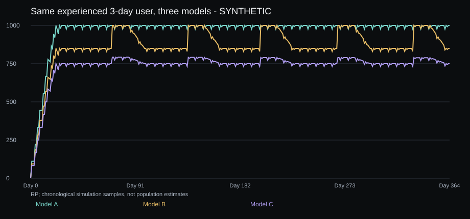
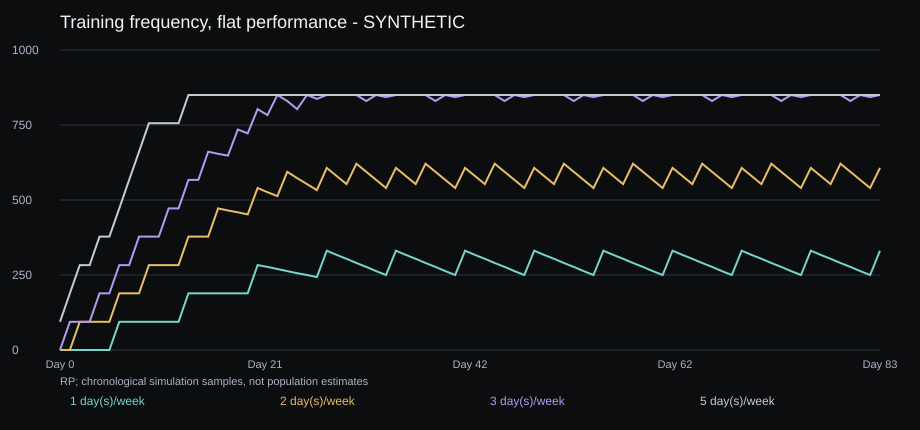
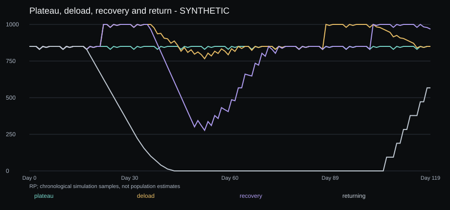
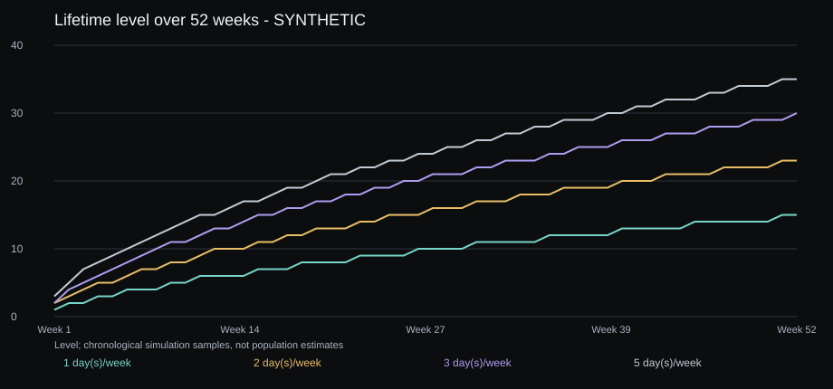
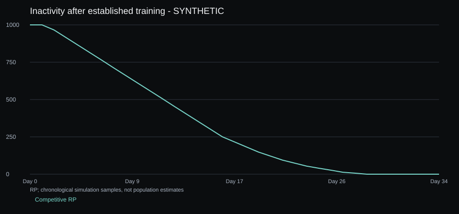

# Executed simulations and balancing

> Historical archive; not current implementation instructions. Read [PROJECT_CONTEXT.md](../../../../PROJECT_CONTEXT.md) and the parent archive index before using this record.

> ARCHIVED DESIGN HISTORY. Do not implement from this document. See ../PRODUCT-SPEC.md
> for the single current specification and ../FINAL-APPROVAL.md for pending approvals.

## Revision 2 - current proposal, owner approval pending

Run `node docs/plans/lifeos-rankings/simulations/revision.mjs`:23 new assertions, exploit reproduction,2/3/4-set comparisons, three calibrated decay mechanisms with daily leagues, recovery/return trajectories and revised762RP fixture. `revision-report.json` is current. The original20-profile/16-assertion run below is retained as VERSION1 comparison evidence, not current policy.

The [final corrections](17-final-product-corrections.md) take precedence over conflicting text below.
## Version 1 reference and comparison (superseded where noted)

Reproduce: `node docs/plans/lifeos-rankings/simulations/run.mjs` from repo root.
Only this planning directory's generated results are written. No API/database
connection, no environment file, no production mutation. Standard-library Node.

Seed is a deterministic pattern set (`patterns-v1-no-randomness`), not a random
sample: 365 dates ending 2026-11-03, 20 profiles, fixed weekly patterns and
synthetic representative performances. Progress statements assume two supporting
working sets/session upstream; secure SQL extraction is not being simulated.

## End states and trajectory evidence

| Profile | XP | Level | Final RP | Mean RP last 28 dates |
|---|---:|---:|---:|---:|
| Beginner, 1/week | 4,160 | 15 | 317 | 357 |
| Beginner, 2/week | 8,830 | 23 | 730 | 680 |
| Beginner, 3/week | 14,020 | 30 | 1,000 | 961 |
| Experienced, 3/week | 14,020 | 30 | 850 | 940 |
| Experienced, 5/week | 18,890 | 35 | 1,000 | 912 |
| High volume, inconsistent | 9,310 | 24 | 445 | 580 |
| Consistent plateau | 14,020 | 30 | 850 | 846 |
| Rapid beginner gains | 14,020 | 30 | 1,000 | 961 |
| Advanced slow gains | 14,020 | 30 | 850 | 940 |
| Deload week | 13,960 | 30 | 850 | 940 |
| Two-week recovery | 13,460 | 29 | 968 | 940 |
| Inactive last month | 12,860 | 28 | 0 | 348 |
| Returned after 3 months | 10,580 | 25 | 567 | 159 |
| Bodyweight rep progress | 14,020 | 30 | 850 | 846 |
| Irregular schedule | 13,820 | 30 | 823 | 923 |
| Split same-day workouts | 14,020 | 30 | 850 | 940 |
| 100-set farming | 14,020 | 30 | 850 | 940 |
| Late historical entries | 13,750 | 29 | 0 | 0 |
| Deleted rewarded history | 13,480 | 29 | 290 | 920 |
| Established member | 14,020 | 30 | 850 | 940 |

The report.json is authoritative if this table is regenerated. Its 365-date
profiles contain partial ISO weeks, so they differ from the exact 52-complete-week
XP table in 03. Deletion occurs on the final date; its 28-date mean is therefore
not the post-deletion steady state. Recovery is earlier in the year, so the final
score is recovered; inspect trajectories around dates 280-294, not only year-end.
The multi-year extension produced 70,370 XP / L71 after five synthetic years.

## What the three candidates showed

On the same experienced three-day profile, final-28-date means were A=995,
B=940 and C=771. Model A fills almost every activity-focused user's top league;
C rewards percentage gain magnitude and pushed all 20 selected end states below
Apex; B preserves an advanced path while keeping a non-progress plateau at 850.
This is scenario evidence, not significance testing or a forecast of adoption.

| End-state raw tiers | Unranked | Silver | Gold | Platinum | Diamond | Apex |
|---|---:|---:|---:|---:|---:|---:|
| A | 2 | 2 | 1 | 2 | 0 | 13 |
| B | 2 | 3 | 1 | 1 | 9 | 4 |
| C | 2 | 3 | 1 | 12 | 2 | 0 |

Bronze is zero in this deliberately established-user set. Counts are raw-point
tiers, not placement/hysteresis-corrected display leagues. Promotions/demotions
for every profile are in summary.csv. Rapid beginners: 15/12, experienced 3-day:
7/5, plateau: 2/0; plateau stability is useful, but rapid-gain rank churn remains
a pilot metric. Do not change thresholds silently to manufacture a desired split.

## Sensitivity

For the experienced three-day stream with 45/40/15 weights, effective-day targets
8/9/10.5/12 produced means 944/940/840/746. Nine was retained: 10.5+ would
strongly favor four days and undermine a three-day route. At target nine,
40/40/20,45/40/15,50/40/10 yielded 921/940/959. Fifteen progress points-percent
is a deliberate middle ground, not a fitted physiological constant.

Progress load thresholds 1/2/3/5% all produced ten events / mean 940 on this
specific advanced 2.5kg-tick stream. This is expected: the tick fallback controls
it. It is NOT proof that percentage choice is irrelevant for lighter loads;
future shadow data must test near-threshold, microplate and per-implement cases.
Apex boundaries 850/900/950 admitted 12/4/4 end states. 900 avoids promoting
plateaus; tiny populations are insufficient to defend a percentile replacement.

The window comparison estimates a whole-day removal cliff for a simple 14-day
box at about 142 RP and 42-day box at about 47 RP. Chosen fading activity loses
about 7 RP per *individual old full day* per daily fade step, before caps; this
does not bound aggregate daily movement when several credits fade together.

## Actual executable assertions

16 named tests cover duplicate payloads, same-day splitting, 100-set inflation,
weight-only inflation, warmups/trivial days, late entries, revision idempotency,
deletion reversal, expiry/no lifetime decay, score bounds, 10,000 level-threshold
inversions, corroboration/context/cooldown, three-day Apex access, and four-day XP
ceiling, frozen competitive dates despite History corrections and mixed-rep
Pareto-frontier progress without e1RM. Source extraction, RLS, scheduling, DST and full production concurrency
are specified acceptance tests, not falsely claimed executed SQL tests.

## Charts

The first run exposed a reporting error: dividing 364 Tuesday-to-Monday dates by
52 mixed partial weeks. Re-run now uses exactly 52 full Monday-Sunday weeks for
frequency XP estimates; the four- and five-day ceiling is asserted equal at 360.
This was an experiment correction, not a modification to production behavior.
